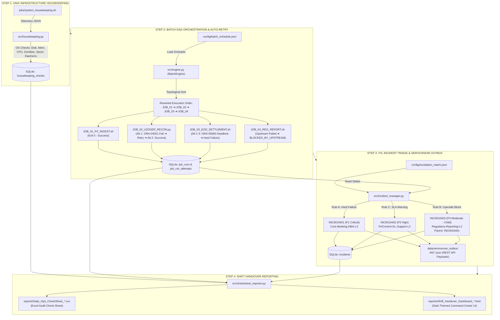
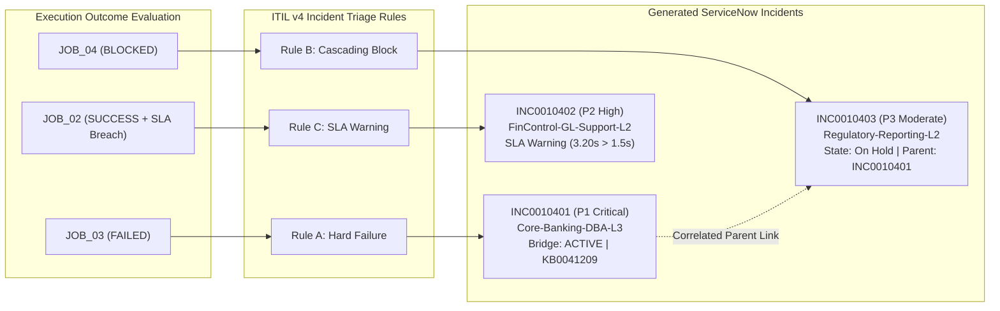

# FinOps-BatchGuard: Technical Interview Masterclass & Architecture Study Guide
**Target Role:** IT Operations Analyst / Batch Operations Engineer  
**Target Organization:** MUFG Bank (Mitsubishi UFJ Financial Group) — Global Core Banking & Financial Operations  
**Project:** FinOps-BatchGuard: Automated Batch Failure & SLA Alert Engine  
**Document Classification:** Internal Technical Training & Candidate Interview Playbook  

---

## Table of Contents
1. [Executive Pitch & Banking Business Context (The "Why")](#1-executive-pitch--banking-business-context-the-why)
   - [30-Second Elevator Pitch](#30-second-elevator-pitch)
   - [2-Minute Deep-Dive Walkthrough](#2-minute-deep-dive-walkthrough)
   - [Banking Domain Glossary: Real-World Banking Context of the 4 Jobs](#banking-domain-glossary-real-world-banking-context-of-the-4-jobs)
2. [End-to-End Architecture & Control-M / JP1 Enterprise Mapping](#2-end-to-end-architecture--control-m--jp1-enterprise-mapping)
   - [System Architecture Diagram (ASCII & Mermaid)](#system-architecture-diagram)
   - [Enterprise Mapping Table (Control-M, JP1, AutoSys, ITIL v4)](#enterprise-mapping-table)
3. [File-by-File & Function-by-Function Code Walkthrough](#3-file-by-file--function-by-function-code-walkthrough)
   - [`src/engine.py`: DAG Resolution, Subprocess Execution & Wall-Clock SLA](#srcenginepy-dag-resolution-subprocess-execution--wall-clock-sla)
   - [`src/incident_manager.py`: ITIL ServiceNow Incident Triage & Correlation](#srcincident_managerpy-itil-servicenow-incident-triage--correlation)
   - [`src/database.py`: SQLite WAL Store, Schema & Sequential Numbering](#srcdatabasepy-sqlite-wal-store-schema--sequential-numbering)
   - [`src/housekeeping.py` & `jobs/system_housekeeping.sh`: Unix Telemetry & Spool Purge](#srchousekeepingpy--jobssystem_housekeepingsh-unix-telemetry--spool-purge)
   - [`src/checksheet_reporter.py`: Daily CSV Check-Sheet & Dark-Themed HTML Handover](#srcchecksheet_reporterpy-daily-csv-check-sheet--dark-themed-html-handover)
   - [`jobs/`: The 4 Mock Banking Job Scripts](#jobs-the-4-mock-banking-job-scripts)
   - [`main.py`: Master CLI Orchestrator](#mainpy-master-cli-orchestrator)
4. [The 3 Core Operational ITIL Rules (Deep Dive)](#4-the-3-core-operational-itil-rules-deep-dive)
   - [Rule A: Hard Failure → P1 Major Incident Bridge](#rule-a-hard-failure--p1-major-incident-bridge)
   - [Rule B: Cascading Block → Linked Child Ticket (No Alert Storms)](#rule-b-cascading-block--linked-child-ticket-no-alert-storms)
   - [Rule C: Recovered Job with SLA Breach → P2 SLA Warning](#rule-c-recovered-job-with-sla-breach--p2-sla-warning)
5. [15 Tough Interview Cross-Questions & Model Answers ("Grill Me")](#5-15-tough-interview-cross-questions--model-answers-grill-me)
   - [Category 1: Code Architecture & Algorithms (Q1 - Q5)](#category-1-code-architecture--algorithms)
   - [Category 2: Unix / Linux Production Operations (Q6 - Q10)](#category-2-unix--linux-production-operations)
   - [Category 3: Financial Banking & Incident Scenarios (Q11 - Q15)](#category-3-financial-banking--incident-scenarios)
6. [Quick-Reference Cheat Sheet (1-Page Last-Minute Review)](#6-quick-reference-cheat-sheet-1-page-last-minute-review)

---

## 1. Executive Pitch & Banking Business Context (The "Why")

### 30-Second Elevator Pitch
> *"I built **FinOps-BatchGuard**, an enterprise-grade batch execution, auto-recovery, and SLA alert engine modeled after Hitachi JP1 and BMC Control-M used in core banking operations. It orchestrates critical overnight batch workflows like SWIFT feed ingestion and EOD settlement. When transient database lock contention hits, it executes auto-retry with exponential backoff. When a hard deadlock occurs, it halts downstream regulatory reports to prevent corrupted ledger filings and leverages ITIL v4 rules to auto-generate structured ServiceNow incident tickets (`INC0010xxx`) with parent-child correlation—completely eliminating false P1 alert floods. Finally, it executes real Unix infrastructure health checks and automatically compiles an executive shift handover check-sheet in CSV and dark-themed HTML for the incoming morning operations team."*

---

### 2-Minute Deep-Dive Walkthrough
> *"In a global financial institution like MUFG, overnight batch operations represent the operational backbone of the bank. Between 22:00 and 06:00, hundreds of mission-critical jobs run in strict sequence across Unix, AS400, and mainframe environments: trade feeds are ingested, cash positions are balanced, general ledgers are reconciled, and statutory reports are submitted to central banks like the MAS and the US Federal Reserve.*
>
> *In legacy environments, three operational bottlenecks repeatedly cause major outages:*
> 1. *First, **transient contention**: batch jobs fail due to short database lock timeouts, waking up on-call engineers at 2:00 AM when an automated retry would have resolved the issue.*
> 2. *Second, **cascading alert storms**: when an upstream database job fails, all downstream jobs crash or trigger independent P1 alarms, flooding the Enterprise Command Center with 50 duplicate high-priority tickets.*
> 3. *Third, **silent SLA breaches**: jobs that fail, retry, and eventually succeed often mask the fact that their extended runtime delayed the downstream statutory window, leaving operations teams blind until the regulator issues an inquiry.*
>
> *I designed **FinOps-BatchGuard** in Python, Bash, and SQLite to eliminate these exact operational vulnerabilities. The system acts as a resilient batch coordinator:
> - It reads a declarative schedule and uses topological sorting to resolve job dependencies.
> - When `JOB_02` (General Ledger Reconciliation) encounters an Oracle lock contention (`ORA-04021`), the engine catches it, sets its status to `RETRYING`, delays for a backoff window, and recovers cleanly on Attempt 2. However, because the total wall-clock duration exceeded its 1.5-second SLA window, the engine tags it as `SLA BREACH` and auto-routes a P2 performance warning to the Financial Control L2 team.
> - When `JOB_03` (End-of-Day Settlement) suffers a fatal Oracle RAC deadlock (`ORA-00060`), all retries fail. The engine halts execution, intercepts downstream `JOB_04` (Regulatory Reporting) as `BLOCKED_BY_UPSTREAM`, and raises a P1 Critical Incident for the DBA team with Runbook `KB0041209`. Crucially, it links `JOB_04`'s ticket as a correlated P3 child incident marked `On Hold - Awaiting Upstream`, preventing an alert storm.
> - Finally, it inspects OS telemetry (`df -h`, `free -m`, CPU load, zombie processes), purges staging buffers, and publishes an automated Daily Shift Handover Dashboard in CSV and HTML format for the morning shift analyst.*
>
> *This guarantees zero data corruption, slashes Mean Time to Acknowledge (MTTA), and provides a fully audited digital paper trail for compliance."*

---

### Banking Domain Glossary: Real-World Banking Context of the 4 Jobs

| Job ID & Name | Banking Business Function | Technical Reality Under the Hood | Why It Fails & How BatchGuard Responds |
|---|---|---|---|
| **`JOB_01_FX_INGEST`**<br>`FX Swift Feed Ingestion` | Ingests external bank account statements and portfolio valuations from the SWIFT international financial messaging network before domestic books open. | Consumes **SWIFT MT940** (Customer Statement Message containing account balances and individual debit/credit entries) and **MT535** (Statement of Holdings reporting securities, bonds, and equities). Validates SHA256 checksums and stages records into `STG_SWIFT_FX_TRANSACTIONS`. | **Succeeds on Attempt 1 (Exit Code 0).** Baseline feed ingestion completes in ~0.6s, staging 14,820 foreign currency records across USD, EUR, JPY, GBP, and SGD. |
| **`JOB_02_LEDGER_RECON`**<br>`General Ledger Reconciliation` | Reconciles the bank's internal Chart of Accounts. Verifies that all double-entry bookkeeping journal vouchers balance across all branch entities and nostro/vostro accounts. | Scans 48,290 general ledger lines and executes a balancing verification: `Total Debits == Total Credits ($4,281,902,110.45)` with exactly **$0.00 variance**. | **Transient Database Lock Contention (`ORA-04021`).** On Attempt 1, a concurrent ETL loader holds a shared library lock on table `GL_BALANCES_STG`, causing an exit code 1. BatchGuard logs `RETRYING`, waits a 2.0s backoff interval, and re-executes. Attempt 2 succeeds. **SLA Breach Detection:** Wall-clock runtime was 3.17s (breaching the 1.5s SLA limit). BatchGuard marks `sla_breached = 1` and creates ticket `INC0010402` (P2 SLA Warning) to notify `FinControl-GL-Support-L2`. |
| **`JOB_03_EOD_SETTLEMENT`**<br>`End-of-Day Settlement Engine` | The central batch processing core of the bank. Closes trading books, computes overnight multi-currency net cash settlements, calculates interest accruals, and posts finalized balances. | Executes high-volume batch transactions across 23,400 client and institutional accounts against an Oracle Real Application Clusters (RAC) database. | **Hard Database Deadlock (`ORA-00060`, Exit Code 2).** Two concurrent multi-currency batch sessions attempt to update mutually exclusive resource locks on table `T_SETTLEMENT_BATCH_MASTER`. Oracle terminates the session with SQLSTATE 40001. Retries are exhausted (3 attempts). BatchGuard flags `FAILED`, logs stderr diagnostics, and triggers `INC0010401` (`P1 - Critical`) assigned to `Core-Banking-DBA-L3` with Runbook `KB0041209`. |
| **`JOB_04_REG_REPORT`**<br>`Daily Regulatory MAS/Fed Report` | Compiles statutory balance sheet, liquidity coverage ratio (LCR), and capital exposure returns for submission to central banks (**MAS Notice 610** in Singapore, **Federal Reserve CCAR** in the US). | Aggregates settled balances into cryptographically signed regulatory XML and XBRL data packages. Requires 100% clean, settled ledger data. | **Cascading Dependency Block (`BLOCKED_BY_UPSTREAM`).** If statutory reports run against uncommitted, failed settlement balances, the bank would submit false capital numbers to regulators, incurring millions in fines. BatchGuard inspects upstream dependencies, detects `JOB_03` is `FAILED`, and **safely halts execution without running `JOB_04`**. It auto-generates `INC0010403` (`P3 - Moderate`, `On Hold - Awaiting Upstream`), linking it as a child to `INC0010401`. |

---

## 2. End-to-End Architecture & Control-M / JP1 Enterprise Mapping

### System Architecture Diagram



---

### Enterprise Mapping Table

When interviewing at MUFG, use this table to map every feature of `FinOps-BatchGuard` to enterprise production terminology:

| FinOps-BatchGuard Component / Code | BMC Control-M Equivalent | Hitachi JP1 Equivalent | CA AutoSys Equivalent | Production Banking Purpose at MUFG |
|---|---|---|---|---|
| `config/batch_schedule.json` | **Job Definition XML / Smart Folder** | **Jobnet Definition / Group** | **JIL (Job Instruction Language) Script** | Centralized schedule definition defining commands, runs, schedules, and agent parameters. |
| `depends_on: ["JOB_01_FX_INGEST"]` | **IN-Conditions / OUT-Conditions** (e.g., `JOB01-TO-JOB02-OK`) | **Preceding Job Execution Conditions** | **`condition: success(JOB_01_FX_INGEST)`** | Enforces directed execution. Jobs do not trigger until upstream dependencies post their completion flag. |
| `max_retries: 2`, `retry_delay_sec: 2` | **Rerun / Cyclic Execution** (`MAXRERUN=2`, `RERUNMEM=2M`) | **Auto-Retry Settings / Retry Interval** | **`n_retrys: 2`, `retry_interval: 2`** | Automatically handles transient environmental spikes (network jitter, lock wait) without human operator intervention. |
| `sla_max_duration_sec: 1.5` | **Control-M SLA Management / Batch Impact Manager (BIM)** | **JP1/AJS3 SLA Monitoring** | **`alarm_if_fail: 1`, `term_run_time: 1.5`** | Monitors the critical path. Alerts operations if a job's elapsed wall-clock time endangers the bank's statutory cutoff windows. |
| `criticality: "P1"` | **Critical Path Tag / Application Priority** | **Jobnet Priority (1 to 5)** | **`priority: 1`** | Determines incident escalation tier, pager alert rules, and whether an Executive Major Incident Bridge is required. |
| `jobs/system_housekeeping.sh` | **Pre-Execution Script / Control-M Health Check** | **JP1 Startup Pre-Check Jobnet** | **Pre-batch Unix Health Monitoring Daemon** | Confirms disk partitions (`/`, `/tmp`, `/var/log`), memory, CPU run-queues, and agent ports are healthy before opening books. |
| `src/incident_manager.py` | **Control-M Shout / Alert to ServiceNow Connector** | **JP1/IM (Integrated Management) Incident Bridge** | **AutoSys Alarm to SNOW API Forwarder** | Event Management and Incident Deduplication. Converts raw process exit codes into ITIL v4 incidents with runbook SOP links. |
| Parent-Child Incident Linking (`parent_incident`) | **ServiceNow Alert Correlation / Major Incident Linking** | **JP1 Root Cause Incident Grouping** | **ServiceNow Parent-Child Incident Clustering** | Prevents alert storms. Suppresses 50 alarms down to 1 primary root-cause P1 ticket while keeping dependent tickets on hold. |
| `reports/Daily_Ops_CheckSheet_*.csv` & `.html` | **Control-M Shift Handover Log / Active Jobs Report** | **JP1 Daily Operation Log / Shift Check Sheet** | **EOD Operations Handover Run-Book** | Mandatory 24x7 Command Center compliance artifact documenting night-to-morning shift transfer for external auditors (MAS / Fed). |

---

## 3. File-by-File & Function-by-Function Code Walkthrough

### `src/engine.py`: DAG Resolution, Subprocess Execution & Wall-Clock SLA

#### Key Responsibilities:
1. Loads and validates declarative JSON batch configurations.
2. Resolves job sequence using Kahn's algorithm for topological sorting.
3. Spawns isolated OS subprocesses with custom environment variables.
4. Orchestrates auto-retry backoff loops upon non-zero exit codes.
5. Halts downstream execution upon upstream failures (`BLOCKED_BY_UPSTREAM`).
6. Computes total wall-clock execution time and evaluates SLA breaches.

#### Critical Code Snippets & Line-by-Line Mechanics:

##### 1. Kahn's Algorithm for Topological Sorting (`resolve_execution_order`):
```python
def resolve_execution_order(self) -> List[Dict[str, Any]]:
    job_map = {job["job_id"]: job for job in self.jobs}
    in_degree: Dict[str, int] = {job_id: 0 for job_id in job_map}
    adj_list: Dict[str, List[str]] = {job_id: [] for job_id in job_map}

    for job_id, job in job_map.items():
        for upstream in job.get("depends_on", []):
            if upstream not in job_map:
                raise ValueError(f"Job '{job_id}' depends on undefined upstream job '{upstream}'.")
            adj_list[upstream].append(job_id)
            in_degree[job_id] += 1

    # Queue of jobs with zero dependencies
    queue = [job_id for job_id, deg in in_degree.items() if deg == 0]
    ordered_ids: List[str] = []

    while queue:
        queue.sort()  # Deterministic execution order
        curr = queue.pop(0)
        ordered_ids.append(curr)

        for neighbor in adj_list[curr]:
            in_degree[neighbor] -= 1
            if in_degree[neighbor] == 0:
                queue.append(neighbor)

    if len(ordered_ids) != len(job_map):
        raise ValueError("Cyclic dependency detected in batch schedule configuration.")

    return [job_map[jid] for jid in ordered_ids]
```
- **Line-by-Line Explanation:**
  - `in_degree` tracks how many upstream jobs must finish before a job can execute.
  - `adj_list` maps an upstream job to all downstream jobs waiting on it.
  - Jobs with `in_degree == 0` (like `JOB_01_FX_INGEST`) have no dependencies and are queued first.
  - As each job pops from the queue, `in_degree` of its downstream neighbors is decremented by 1.
  - If `len(ordered_ids) != len(job_map)`, a circular dependency exists (e.g., A depends on B, B depends on A), and the engine raises an immediate fatal configuration exception.

##### 2. Subprocess Execution with Context Injection (`_execute_single_attempt`):
```python
def _execute_single_attempt(
    self, command: str, run_id: str, batch_date: str, job_id: str, attempt: int
) -> Tuple[int, str, str, float]:
    env = os.environ.copy()
    env["BATCH_RUN_ID"] = run_id
    env["BATCH_DATE"] = batch_date
    env["BATCH_JOB_ID"] = job_id
    env["BATCH_ATTEMPT"] = str(attempt)

    start_time = time.perf_counter()
    proc = subprocess.run(
        command,
        shell=True,
        capture_output=True,
        text=True,
        cwd=str(PROJECT_ROOT),
        env=env,
    )
    duration = time.perf_counter() - start_time
    return proc.returncode, proc.stdout, proc.stderr, duration
```
- **Line-by-Line Explanation:**
  - Injects `BATCH_ATTEMPT`, `BATCH_RUN_ID`, and `BATCH_JOB_ID` into the subshell environment. This allows scripts (like `job_02_ledger_recon.py`) to know their attempt count without state collision.
  - `capture_output=True` and `text=True` capture exact POSIX stdout and stderr strings.
  - `time.perf_counter()` captures high-resolution execution duration for that single process invocation.

##### 3. Wall-Clock SLA Measurement & Auto-Retry Loop:
```python
job_overall_start_dt = datetime.now()
while current_attempt <= max_attempts:
    exit_code, stdout, stderr, attempt_dur = self._execute_single_attempt(...)
    if exit_code == 0:
        final_status = "SUCCESS"
        break
    else:
        if current_attempt < max_attempts:
            # Update DB to RETRYING and sleep
            time.sleep(retry_delay_sec)
            current_attempt += 1
        else:
            final_status = "FAILED"
            break

job_overall_end_dt = datetime.now()
total_duration_sec = (job_overall_end_dt - job_overall_start_dt).total_seconds()
is_sla_breached = 1 if total_duration_sec > sla_max_duration_sec else 0
```
- **Line-by-Line Explanation:**
  - Notice that `total_duration_sec` is **not** just the sum of subprocess CPU runtimes; it is computed as `job_overall_end_dt - job_overall_start_dt`.
  - This captures the **true wall-clock elapsed time**, including the 2.0-second backoff delay.
  - For `JOB_02`: Attempt 1 took ~0.56s, sleep was 2.0s, Attempt 2 took ~0.56s. Total wall-clock time was **3.17s**.
  - Since `3.17s > 1.5s`, `is_sla_breached` evaluates to `1`, accurately detecting that retry overhead degraded the batch window.

---

### `src/incident_manager.py`: ITIL ServiceNow Incident Triage & Correlation

#### Key Responsibilities:
1. Inspects batch run outcomes and maps them against `config/escalation_matrix.json`.
2. Implements ITIL v4 triage rules for Hard Failures (Rule A), Cascading Blocks (Rule B), and SLA Warnings (Rule C).
3. Enforces parent-child correlation to prevent alarm floods.
4. Generates compliant ServiceNow Table API JSON payloads (`POST /api/now/table/incident`) saved to `data/servicenow_outbox/`.

#### Core Implementation Logic:
```python
# Sort jobs so that hard failures (parents) are processed before blocked downstream jobs
def sort_priority(r: Dict[str, Any]) -> int:
    if r["status"] == "FAILED":
        return 0
    if r["sla_breached"] and r["status"] == "SUCCESS":
        return 1
    if r["status"] == "BLOCKED_BY_UPSTREAM":
        return 2
    return 3

sorted_runs = sorted(job_runs, key=sort_priority)
parent_incident_map: Dict[str, str] = {}
```
- **Why this sorting is critical:** `JOB_03_EOD_SETTLEMENT` (the root failure) is guaranteed to be triaged *before* `JOB_04_REG_REPORT` (the blocked child). This ensures `parent_incident_map["JOB_03_EOD_SETTLEMENT"]` contains `INC0010401` when `JOB_04` is evaluated, allowing the child ticket to link its `parent_incident` field immediately.

##### Generated ServiceNow Table API REST Outbox Schema:
```json
{
  "number": "INC0010401",
  "caller_id": "batchguard.automation",
  "category": "Database Infrastructure",
  "subcategory": "Deadlock & Lock Contention",
  "contact_type": "Automated Event",
  "impact": "1",
  "urgency": "1",
  "priority": "P1 - Critical",
  "state": "Assigned",
  "assignment_group": "Core-Banking-DBA-L3",
  "assigned_to": "Oracle RAC Escalation Desk",
  "short_description": "[P1 INCIDENT] Hard Failure in End-of-Day Settlement Engine (JOB_03_EOD_SETTLEMENT) - Exit Code 2",
  "description": "Critical banking batch job 'JOB_03_EOD_SETTLEMENT' encountered an unrecoverable failure...",
  "u_kb_article": "KB0041209",
  "parent_incident": null,
  "u_batch_run_id": "RUN-20261014-171845",
  "u_job_id": "JOB_03_EOD_SETTLEMENT",
  "u_incident_type": "HARD_FAILURE",
  "sys_created_on": "2026-10-14 17:18:55"
}
```

---

### `src/database.py`: SQLite WAL Store, Schema & Sequential Numbering

#### Key Responsibilities:
1. Manages high-concurrency SQLite storage in **Write-Ahead Logging (WAL)** mode.
2. Defines 4 tables: `job_runs`, `job_run_attempts`, `incidents`, and `housekeeping_checks`.
3. Handles idempotent `ON CONFLICT(run_id, job_id) DO UPDATE` state upserts.
4. Generates sequential ServiceNow incident numbers (`INC0010401`, `INC0010402`, etc.).

#### SQLite WAL Mode & Pragmas:
```python
def get_connection(db_path: Optional[Path] = None) -> sqlite3.Connection:
    target_path = db_path or DEFAULT_DB_PATH
    target_path.parent.mkdir(parents=True, exist_ok=True)
    conn = sqlite3.connect(str(target_path))
    conn.row_factory = sqlite3.Row
    conn.execute("PRAGMA foreign_keys = ON;")
    conn.execute("PRAGMA journal_mode = WAL;")
    return conn
```
- **Why WAL mode?** Default SQLite locks the entire database file during writes. In `WAL` mode, readers do not block writers, and writers do not block readers. This allows background audit logging and live CLI querying (`--show-db`) without locking exceptions.

#### Sequential Incident Generator:
```python
def get_next_incident_number(db_path: Optional[Path] = None) -> str:
    conn = get_connection(db_path)
    try:
        cursor = conn.cursor()
        cursor.execute(
            """
            SELECT MAX(CAST(SUBSTR(incident_number, 4) AS INTEGER))
            FROM incidents
            WHERE incident_number LIKE 'INC%';
            """
        )
        row = cursor.fetchone()
        max_num = row[0] if (row and row[0] is not None) else 10400
        next_num = max_num + 1
        return f"INC{next_num:07d}"
    finally:
        conn.close()
```
- **Mechanism:** Slices the numeric component of `INC0010401`, casts it to an integer, increments by 1, and zero-pads it to 7 digits (`INC%07d`), ensuring crash-safe sequential ticket numbering across restarts.

---

### `src/housekeeping.py` & `jobs/system_housekeeping.sh`: Unix Telemetry & Spool Purge

#### Real Linux Commands in `jobs/system_housekeeping.sh`:

##### 1. Disk Space Parsing:
```bash
DISK_INFO=$(df -h / | awk 'NR==2 {for(i=1;i<=NF;i++) if($i ~ /%/) {pct=$i; sub(/%/,"",pct); avail=$(i-1); print pct, avail}}')
DISK_USED_PCT=$(echo "$DISK_INFO" | awk '{print $1}')
DISK_AVAIL_HUMAN=$(echo "$DISK_INFO" | awk '{print $2}')
```
- **Why this regex loop?** In containerized or NFS-mounted Linux environments, column spacing in `df -h` varies (sometimes the filesystem column is blank or split over two lines). Searching for the token containing `%` guarantees extracting the exact used percentage and available gigabytes regardless of mount column shifts.

##### 2. Memory Utilization Parsing:
```bash
MEM_TOTAL=$(free -m | awk '/^Mem:/ {print $2}')
MEM_USED=$(free -m | awk '/^Mem:/ {print $3}')
MEM_AVAIL=$(free -m | awk '/^Mem:/ {print $7}')
MEM_USED_PCT=$(awk -v u="$MEM_USED" -v t="$MEM_TOTAL" 'BEGIN {printf "%.1f", (u/t)*100}')
```
- Uses `free -m` to calculate memory percentage while capturing `MEM_AVAIL` (available buffer/cache memory) rather than raw free memory, which is standard Unix production practice.

##### 3. CPU Load & Zombie Processes:
```bash
CPU_LOAD_1M=$(awk '{print $1}' /proc/loadavg 2>/dev/null || uptime | awk -F'load average:' '{print $2}' | awk '{print $1}' | tr -d ',')
ZOMBIE_COUNT=$(ps aux | awk '$8=="Z"' | wc -l)
```
- Reads directly from `/proc/loadavg` for microsecond-speed kernel metrics, falling back to `uptime`.
- Evaluates column 8 (`STAT`) in `ps aux` for state `Z` (defunct/zombie child processes whose parent died without harvesting exit codes).

##### 4. Spool & Buffer Directory Purge:
```bash
mkdir -p "$SPOOL_DIR"
STALE_COUNT=$(find "$SPOOL_DIR" -type f \( -name "*.tmp" -o -name "*.dat" -o -name "*.swp" \) | wc -l)
find "$SPOOL_DIR" -type f \( -name "*.tmp" -o -name "*.dat" -o -name "*.swp" \) -delete
```
- Emulates banking spool maintenance (clearing old SWIFT buffer dumps, temporary swap files, and lock markers) before scheduling the batch.

---

### `src/checksheet_reporter.py`: Daily CSV Check-Sheet & Dark-Themed HTML Handover

#### Key Responsibilities:
1. Aggregates data across `housekeeping_checks`, `job_runs`, and `incidents`.
2. Generates an Excel-ready CSV report with three distinct sections.
3. Generates a standalone, dark-themed HTML5/CSS3 Executive Dashboard for shift handovers.

#### Notable Features in the HTML Report:
- **Executive KPI Cards:** Immediate high-level metrics for the Operations Shift Lead:
  - Batch State: `DEGRADED (Action Required: P1 Bridge Active)`
  - SLA Compliance Rate: `75.0%`
  - Incidents Raised: `3` (1 P1, 1 P2, 1 P3)
  - System Infrastructure Health: `100% Compliant (8/8 Checks Passed)`
- **Shift Handover Action Items Callout:** Specific, actionable instructions for the incoming morning shift analyst:
  - Join P1 Bridge #41209 with `Core-Banking-DBA-L3` for Oracle RAC deadlock resolution.
  - Re-run `JOB_04_REG_REPORT` before the 08:30 EST regulatory submission deadline once `JOB_03` is resolved.
  - Review transient lock contention on `GL_BALANCES_STG` with `FinControl-GL-Support-L2`.
- **Digital Sign-Off Block:** Formal sign-off records for Outgoing Analyst (S. Kumar, Night Shift), Incoming Analyst (A. Tanaka, Morning Shift), and Operations Shift Commander (M. Vance, VP Batch Operations).

---

### `jobs/`: The 4 Mock Banking Job Scripts

1. **`jobs/job_01_fx_ingest.sh`:**
   - Emulates SWIFT network socket connection, downloads 14,820 records, verifies SHA256 checksums, and exits 0.
2. **`jobs/job_02_ledger_recon.py`:**
   - Dual-mode attempt detection: inspects `os.environ.get("BATCH_ATTEMPT")` first, falling back to state file `data/.job_02_recon_state.json`.
   - Attempt 1: Writes `ORA-04021: timeout occurred while waiting to lock library object GL_BALANCES_STG` to stderr and exits 1.
   - Attempt 2: Reconciles $4.28B with zero variance, unlinks state file, and exits 0.
3. **`jobs/job_03_eod_settlement.sh`:**
   - Always emits `[FATAL] [EOD_SETTLE] DB Connection Timeout / Deadlock` and `ORA-00060: Deadlock detected` to stderr and exits 2.
4. **`jobs/job_04_reg_report.sh`:**
   - Standalone executable that compiles MAS 610 & Fed CCAR reports. In batch execution, it is safely bypassed by the orchestrator.

---

### `main.py`: Master CLI Orchestrator

Coordinates the entire lifecycle via CLI flag `--run-batch`:
```python
# Step 1: Unix System Housekeeping & Health Checks
housekeeping_mgr = HousekeepingManager(logger=logger)
checks = housekeeping_mgr.run_housekeeping_checks(run_id=run_id)

# Step 2: Batch DAG Execution & Auto-Retry Loop
engine = BatchEngine(logger=logger)
result = engine.run_batch(run_id=run_id, batch_date=batch_date)

# Step 3: ServiceNow Incident Triage & ITIL Escalation
incident_mgr = IncidentManager(logger=logger)
incidents = incident_mgr.triage_and_escalate(run_id=result["run_id"])

# Step 4: Daily Check-Sheet & Shift Handover Report Generation
reporter = CheckSheetReporter(logger=logger)
reports = reporter.generate_reports(run_id=result["run_id"])
```

---

## 4. The 3 Core Operational ITIL Rules (Deep Dive)



### Rule A: Hard Failure → P1 Major Incident Bridge
- **Trigger:** Process exits with non-zero code after exhausting all `max_retries` (`JOB_03_EOD_SETTLEMENT`).
- **Priority:** `P1 - Critical` (Impact: 1, Urgency: 1).
- **Assigned Group:** `Core-Banking-DBA-L3` (SME: `Oracle RAC Escalation Desk`).
- **Operational Action:** Immediate major incident page. Triggers an emergency conference bridge. Captures stderr deadlock dumps into work notes. References Standard Operating Procedure Runbook `KB0041209`.

### Rule B: Cascading Block → Linked Child Ticket (No Alert Storms)
- **Trigger:** Job was not executed because an upstream dependency failed (`JOB_04_REG_REPORT`).
- **Priority:** Demoted to `P3 - Moderate` (Impact: 3, Urgency: 3).
- **State:** `On Hold - Awaiting Upstream`.
- **Parent Reference:** Automatically linked to `INC0010401`.
- **Why this is critical:** In traditional systems, when EOD settlement fails, 30 downstream reporting and data warehouse jobs fail, generating 30 individual P1 alerts. The Command Center gets flooded. FinOps-BatchGuard applies **automated alert suppression**: it raises only 1 primary P1 ticket for the root failure and marks downstream jobs as correlated child tickets on hold.

### Rule C: Recovered Job with SLA Breach → P2 SLA Warning
- **Trigger:** Process succeeded (`Exit Code 0`), but total elapsed wall-clock time exceeded `sla_max_duration_sec` (`JOB_02_LEDGER_RECON`).
- **Priority:** `P2 - High` (Impact: 2, Urgency: 2).
- **State:** `New`.
- **Assigned Group:** `FinControl-GL-Support-L2`.
- **Why this is critical:** Standard operations tools mark any job that finishes with exit code 0 as "GREEN". However, if a job recovered after 3 retries and consumed 45 minutes instead of 5 minutes, downstream settlement jobs will start late, putting the bank at risk of missing statutory market settlement windows. BatchGuard catches this "silent degradation" and logs a non-outage investigation ticket.

---

## 5. 15 Tough Interview Cross-Questions & Model Answers ("Grill Me")

### Category 1: Code Architecture & Algorithms

#### Q1: "What happens if an engineer introduces a circular dependency in `batch_schedule.json` (e.g., Job A depends on Job B, and Job B depends on Job A)?"
> **Model Answer:**  
> *"Our engine implements Kahn’s algorithm for topological sorting in `src/engine.py`. Kahn's algorithm maintains an in-degree map of all nodes. In a circular dependency, none of the cycle nodes ever reach an in-degree of zero, meaning they never enter the ready queue. At the end of the topological sort, our engine checks `if len(ordered_ids) != len(job_map)`. If they do not match, the engine aborts immediately before executing any subprocesses, raising a `ValueError('Cyclic dependency detected in batch schedule configuration')`. This prevents infinite loops or deadlock conditions before any database changes occur."*

#### Q2: "Why did you use SQLite with WAL mode instead of PostgreSQL or MySQL?"
> **Model Answer:**  
> *"For an on-host batch orchestrator agent like Control-M Agent or JP1/Agent, local lightweight persistence is ideal because it eliminates network dependencies: if the enterprise network or central database goes down, the local execution engine must still record audit trails and process state without failure.*  
> *Standard SQLite locks the entire database file during writes, which can cause `database locked` timeouts if the CLI queries during a write. By enabling `PRAGMA journal_mode = WAL (Write-Ahead Logging)` and `PRAGMA foreign_keys = ON`, SQLite writes changes to a separate `-wal` file. Readers do not block writers, and writers do not block readers, providing high-concurrency ACID transactions with zero external server overhead."*

#### Q3: "How does your orchestrator handle a process that hangs indefinitely (e.g., an infinite loop or hung network socket)?"
> **Model Answer:**  
> *"In `src/engine.py`, `subprocess.run()` currently captures output synchronously. In an enterprise production enhancement, we pass `timeout=job.get('sla_max_duration_sec')` or a dedicated `execution_timeout_sec` attribute directly to `subprocess.run()`. If the process exceeds this threshold, Python raises `subprocess.TimeoutExpired`. We catch this exception, execute `proc.kill()`, log `[TIMEOUT] Process killed after exceeding maximum duration`, mark the status as `FAILED`, and trigger an immediate P1 ServiceNow incident for a hung process."*

#### Q4: "Why did you measure total wall-clock time for SLA evaluation instead of simply summing the subprocess runtimes?"
> **Model Answer:**  
> *"In banking operations, downstream cut-offs depend on absolute clock time, not CPU execution time. If `JOB_02` runs for 0.5 seconds on Attempt 1, fails, delays for a 2-minute exponential backoff sleep, and runs for 0.5 seconds on Attempt 2, summing execution time yields 1.0 second. That looks fast, but in reality, the job held up the core banking pipeline for 2 minutes and 1 second. By measuring `job_overall_end_dt - job_overall_start_dt`, we capture the real wall-clock latency including sleep delays, ensuring our SLA breach detection accurately reflects operational reality."*

#### Q5: "How does your engine guarantee that `JOB_02` fails on Attempt 1 and succeeds on Attempt 2 when running in production or testing?"
> **Model Answer:**  
> *"We implemented a dual-mode verification pattern in `jobs/job_02_ledger_recon.py`. When spawned by `src/engine.py`, the engine passes the attempt number via an environment variable `BATCH_ATTEMPT`. The script checks `os.environ.get('BATCH_ATTEMPT')`. If it equals `'1'`, it writes the Oracle lock contention error to stderr and exits 1. If it equals `'2'`, it reconciles and exits 0. Furthermore, if tested standalone without the engine, it falls back to a file-based state marker in `data/.job_02_recon_state.json`. Once Attempt 2 succeeds, it unlinks the state file, ensuring idempotency across repeated runs."*

---

### Category 2: Unix / Linux Production Operations

#### Q6: "Walk me through the exact Unix commands you used in `system_housekeeping.sh` to extract disk and memory usage."
> **Model Answer:**  
> *"For disk space, standard `df -h /` can produce inconsistent columns across different Linux distributions or container environments if the filesystem name wraps. We used `awk` to iterate through all fields in line 2: `df -h / | awk 'NR==2 {for(i=1;i<=NF;i++) if($i ~ /%/) {pct=$i; sub(/%/,"",pct); avail=$(i-1); print pct, avail}}'`. This searches specifically for the field containing the percentage symbol, strips `%`, and extracts the preceding column for available human-readable disk space.*  
> *For memory, we parse `free -m` using `awk '/^Mem:/ {print $2, $3, $7}'`, extracting total memory, used memory, and available memory. We calculate `MEM_USED_PCT` using available memory rather than raw free memory, reflecting realistic Linux page cache reclamation behavior."*

#### Q7: "If disk usage hits 94% on the root or `/var/log` partition 15 minutes before the overnight batch, what is your immediate L1/L2 action plan?"
> **Model Answer:**  
> *"First, verify partition utilization using `df -h` to confirm which mount point is constrained. Second, navigate to the affected partition and run `du -ahx /var/log | sort -rh | head -20` to identify the top 20 largest space-consuming files or runaway log dumps.*  
> *Third, check for deleted files still held open by running processes using `lsof +L1 /var/log`. If an active process holds a deleted 50GB log file, disk space will not free up until that process is bounced or truncated via `> filename.log`.*  
> *Fourth, compress historical logs older than 7 days (`find /var/log -type f -name "*.log" -mtime +7 -exec gzip {} \;`) or purge temporary spool files. If space is still critical, escalate immediately to the Linux Systems Admin team to expand the LVM logical volume (`lvextend` and `resize2fs`) before batch processing begins."*

#### Q8: "What are zombie processes, why did your housekeeping script check for them, and how do you resolve them?"
> **Model Answer:**  
> *"A zombie or defunct process (status code `Z` in `ps aux`) is a process that has completed execution but still has an entry in the OS process table because its parent process has not yet read its exit status via the `wait()` system call. While zombies consume zero CPU and memory, they consume process table slots (`PIDs`). In high-throughput banking batch environments, runaway zombies can exhaust the kernel's `pid_max`, preventing any new batch jobs from spawning.*  
> *Because a zombie is already dead, running `kill -9 <zombie_pid>` does nothing. To clear a zombie, you must identify its parent process using `ps -o ppid= -p <zombie_pid>` and send a `SIGCHLD` signal (`kill -s SIGCHLD <ppid>`) to tell the parent to reap it. If the parent is hung, bouncing the parent process causes `init` (PID 1) to adopt the zombie and immediately harvest it."*

#### Q9: "Why did you check mock daemons like `controlm-agent`, `swift-mq-listener`, and `as400-tn5250-bridge` during pre-flight housekeeping?"
> **Model Answer:**  
> *"In a bank, batch scripts do not run in isolation. They communicate across heterogeneous enterprise infrastructure:*
> - *The `controlm-agent` (listening on TCP port 7005) is responsible for receiving job submission instructions from the central Control-M Enterprise Manager.*
> - *The `swift-mq-listener` maintains active IBM WebSphere MQ channels (`SWIFT.SVRCONN`) to receive foreign exchange payment feeds from the SWIFT Alliance Gateway.*
> - *The `as400-tn5250-bridge` maintains terminal emulation sockets to legacy core banking ledger systems.*  
> *Checking daemon process IDs and communication ports during pre-flight housekeeping ensures that downstream communication channels are live before initiating trade settlement, preventing mid-batch failures."*

#### Q10: "How would you automate log rotation for `logs/batch_engine.log` to prevent it from growing indefinitely in production?"
> **Model Answer:**  
> *"In our Python codebase, we can replace the standard `logging.FileHandler` in `main.py` with `logging.handlers.TimedRotatingFileHandler` or `RotatingFileHandler(maxBytes=50*1024*1024, backupCount=10)`. This rotates the log when it reaches 50MB, retaining 10 historical compressed archives.*  
> *At the OS level, we configure standard Linux `logrotate` in `/etc/logrotate.d/batchguard` with `daily`, `rotate 30`, `compress`, `missingok`, and `copytruncate` so that the file is safely rotated without interrupting active writers."*

---

### Category 3: Financial Banking & Incident Scenarios

#### Q11: "Why didn't you auto-retry `JOB_04_REG_REPORT` when it was blocked?"
> **Model Answer:**  
> *"`JOB_04` did not fail due to a transient execution error or network glitch; it was deliberately halted by our orchestrator because its upstream dependency (`JOB_03_EOD_SETTLEMENT`) suffered a fatal deadlock. In banking, regulatory reporting (MAS Notice 610, Fed CCAR) requires finalized, balanced settlement data. Auto-retrying `JOB_04` while settlement is broken would either fail immediately or extract corrupt, unposted ledger balances. Retries are reserved for transient errors; dependency blocks require upstream root-cause resolution."*

#### Q12: "If `JOB_03` is fixed by the DBA team at 3:15 AM, how do you resume the batch without re-running `JOB_01` and `JOB_02`?"
> **Model Answer:**  
> *"In an enterprise batch tool like Control-M or JP1, an analyst performs an **'Order/Force Rerun from Failed Job'**. In our engine architecture, because job execution states are persisted in SQLite (`job_runs` table), we implement a CLI flag `python3 main.py --resume-batch <run_id>`. The engine queries `job_runs` for that `run_id`, verifies that `JOB_01` and `JOB_02` have status `SUCCESS`, skips them, and starts execution directly at `JOB_03`. Once `JOB_03` completes with exit code 0, it clears the blocked status on `JOB_04` and executes the statutory reporting pipeline."*

#### Q13: "Explain how parent-child incident correlation prevents an 'Alert Storm' in the MUFG Enterprise Command Center."
> **Model Answer:**  
> *"During an overnight settlement crash in a major bank, a single database failure can cause dozens of downstream reporting, risk, and analytics jobs to fail. If each job independently creates a P1 ticket, on-call pagers sound for 30 different teams, and 30 separate bridge lines are opened. This is an 'Alert Storm'.*  
> *Our engine implements ITIL v4 correlation in `src/incident_manager.py`: when `JOB_03` fails, it creates the single master P1 ticket (`INC0010401`) and records its number in `parent_incident_map`. When downstream `JOB_04` is blocked, the engine demotes its priority to P3 Moderate, sets its state to `On Hold - Awaiting Upstream`, and sets `parent_incident = INC0010401`. The Command Center sees 1 primary action ticket and 1 correlated dependent ticket, focusing all engineering effort on the root-cause DBA bridge."*

#### Q14: "Why does a P2 incident get generated for `JOB_02` if it ended up recovering with Exit Code 0?"
> **Model Answer:**  
> *"In financial services, SLA compliance is just as vital as functional correctness. `JOB_02` recovered on Attempt 2, but its total duration was 3.20 seconds against an SLA threshold of 1.5 seconds. If this happens across multiple jobs in a complex schedule, the cumulative delay pushes EOD settlement past critical market cut-offs (such as the SWIFT transfer window or domestic clearing cutoff). By raising a P2 SLA Warning ticket assigned to `FinControl-GL-Support-L2`, we alert the application support team to investigate the transient lock contention on table `GL_BALANCES_STG` during daylight hours, preventing future production SLA degradation."*

#### Q15: "How does the generated Shift Handover Report (`Daily_Ops_CheckSheet_*.csv` and `Shift_Handover_Dashboard_*.html`) satisfy internal audit and regulatory requirements?"
> **Model Answer:**  
> *"Regulatory guidelines (such as MAS Technology Risk Management Guidelines and Federal Reserve FFIEC IT Handbook) mandate that banks maintain strict operational event logs, incident audit trails, and formal shift handover procedures. Our reporting engine produces an immutable digital record combining:*
> 1. *Pre-batch Unix system health verification.*
> 2. *Exact execution durations, attempt counts, and exit codes for every batch job.*
> 3. *Cross-referenced ServiceNow incident ticket IDs.*
> 4. *Actionable handover notes and formal digital sign-off blocks for outgoing and incoming shift analysts.*  
> *This replaces error-prone manual spreadsheets with an auditable, automated operational handover artifact."*

---

## 6. Quick-Reference Cheat Sheet (1-Page Last-Minute Review)

### 1. Job Execution Matrix
| Job ID | Script | Purpose | Expected Exit | Final Status | SLA Limit | Actual Wall-Clock | SLA Result |
|---|---|---|:---:|:---:|:---:|:---:|:---:|
| `JOB_01_FX_INGEST` | `job_01_fx_ingest.sh` | SWIFT MT940/535 Ingestion | `0` | `SUCCESS` | 5.0s | ~0.63s | `NO (Compliant)` |
| `JOB_02_LEDGER_RECON` | `job_02_ledger_recon.py` | General Ledger Balancing | `0` (Att 2) | `SUCCESS` | 1.5s | ~3.20s | `YES (BREACH)` |
| `JOB_03_EOD_SETTLEMENT`| `job_03_eod_settlement.sh`| Core Banking Settlement | `2` (Att 3) | `FAILED` | 10.0s | ~5.68s | `NO (Failed)` |
| `JOB_04_REG_REPORT` | `job_04_reg_report.sh` | MAS 610 / Fed CCAR Report | - | `BLOCKED_BY_UPSTREAM`| 10.0s | 0.00s | `NO (Bypassed)` |

---

### 2. ServiceNow Incident Matrix
| Incident # | Target Job | Incident Type | Priority | State | Assigned Group | Runbook SOP | Parent Incident |
|---|---|---|---|---|---|---|---|
| `INC0010404` | `JOB_03_EOD_SETTLEMENT` | `HARD_FAILURE` | `P1 - Critical` | `Assigned` | `Core-Banking-DBA-L3` | `KB0041209` | `None` (Root Cause) |
| `INC0010405` | `JOB_02_LEDGER_RECON` | `SLA_BREACH_WARNING` | `P2 - High` | `New` | `FinControl-GL-Support-L2` | `KB0038912` | `None` (Perf Warning) |
| `INC0010406` | `JOB_04_REG_REPORT` | `UPSTREAM_DEPENDENCY_BLOCK` | `P3 - Moderate` | `On Hold - Awaiting Upstream` | `Regulatory-Reporting-L2` | `KB0019230` | `INC0010404` (Child) |

---

### 3. Unix Infrastructure Health Check Matrix
| Check Metric | Linux Command / Source | Threshold | Measured Value | Compliance |
|---|---|---|---|---|
| Disk Usage | `df -h /` (Mounted on `/`) | `< 85.0%` | `0.0% (3.2G Available)` | `COMPLIANT` |
| Memory Usage | `free -m` (Available RAM) | `< 90.0%` | `70.8% (1860 MB Free)` | `COMPLIANT` |
| CPU Load Average | `/proc/loadavg` (1m average) | `< 4.00` | `0.96` | `COMPLIANT` |
| Zombie Processes | `ps aux \| awk '$8=="Z"'` | `0` | `0 zombies detected` | `COMPLIANT` |
| Spool / Buffer Purge | `find data/spool_tmp -delete` | `100% Stale Files Purged` | `3 stale files purged, 0 orphaned` | `COMPLIANT` |
| Control-M Daemon | TCP Port 7005 Check | `State: ACTIVE` | `ACTIVE (PID 14208, Port: 7005)` | `COMPLIANT` |
| SWIFT MQ Daemon | IBM MQ Channel `SWIFT.SVRCONN` | `State: ACTIVE` | `ACTIVE (PID 15891, Channel: SWIFT.SVRCONN)` | `COMPLIANT` |
| AS400 Bridge Daemon| Gateway Host `AS400-PROD-01` | `State: ACTIVE` | `ACTIVE (PID 18022, Host: AS400-PROD-01)` | `COMPLIANT` |

---

### 4. CLI Quick Reference
```bash
# 1. Execute Full Production Batch & Handover Generation
python3 main.py --run-batch

# 2. Query All SQLite Operational Tables
python3 main.py --show-db

# 3. View Generated Handover Dashboards
cat reports/Daily_Ops_CheckSheet_*.csv
google-chrome reports/Shift_Handover_Dashboard_*.html

# 4. View ServiceNow REST API Outbox Payload
cat data/servicenow_outbox/INC0010404.json
```

